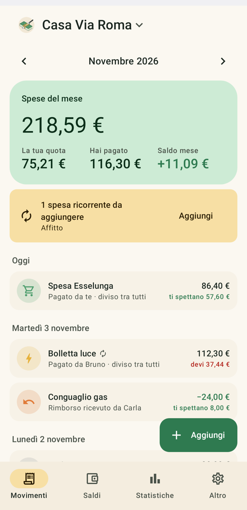
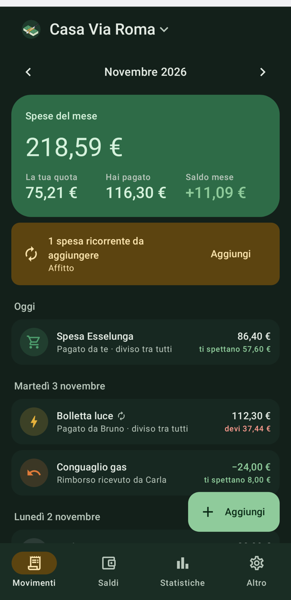
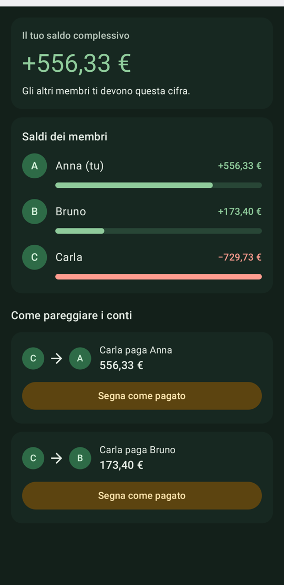
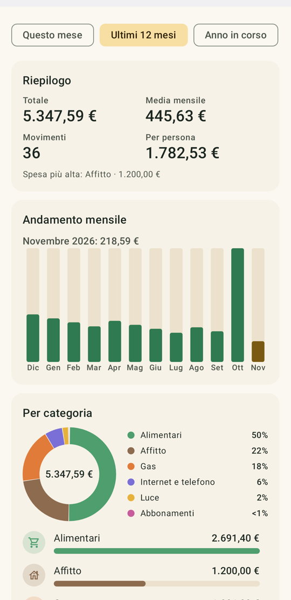

<p align="center">
  
  
</p>

# myFifty

App Android per dividere le spese di casa tra coinquilini, mese per mese.
Dati salvati su [Supabase](https://supabase.com) e sincronizzati in tempo reale tra i membri.

<p align="center">
  
  
  
  
</p>

## Funzioni

- **Case e membri**: crea una casa e invita gli altri con un codice di 8 caratteri. Puoi far parte di più case.
- **Tre tipi di movimento**
  - *Spesa*: pagata da un membro, divisa in parti uguali tra i membri scelti;
  - *Rimborso*: soldi ricevuti da un membro (conguaglio bolletta, reso…) che spettano a più persone;
  - *Saldo*: un membro restituisce soldi a un altro.
- **Modificabili in ogni momento**, anche da altri membri (l'app mostra chi ha fatto l'ultima modifica).
- **Categorie**: alimentari, luce, gas, acqua, internet e telefono, abbonamenti, affitto, condominio,
  prodotti per la casa, manutenzione, altro.
- **Spese ricorrenti** (affitto, internet…): ogni mese l'app propone di ricopiarle.
- **Vista mensile** con totale, la tua quota, quanto hai pagato e il saldo del mese.
- **Saldi** complessivi di ogni membro e suggerimento del minor numero di pagamenti per pareggiare,
  con registrazione del saldo in un tocco.
- **Statistiche**: andamento mensile, ripartizione per categoria, chi ha pagato cosa, medie;
  per mese, ultimi 12 mesi, anno in corso o tutto.
- **Sincronizzazione automatica** via Supabase Realtime: quello che inseriscono gli altri compare
  subito. Si aggiorna anche trascinando giù la lista o quando riapri l'app.
- **Import/Export**: backup JSON completo (reimportabile senza duplicati, anche in un'altra casa)
  e CSV con `;` per Excel / Fogli Google. L'import accetta anche CSV scritti a mano.
- **Tema chiaro/scuro** che segue il telefono (o forzato dalle impostazioni). Logo, icona e splash
  screen cambiano con il tema; icona monocromatica per le icone a tema di Android 13+.

## Configurazione

1. **Supabase**: segui [docs/SUPABASE_SETUP.md](docs/SUPABASE_SETUP.md) (crei il progetto ed esegui
   [`supabase/schema.sql`](supabase/schema.sql)).
2. **Installazione**: scarica l'APK dagli *Artifacts* dell'ultima esecuzione di
   [GitHub Actions](../../actions) oppure dalle *Releases* (pubblicate a ogni tag `v*`, es. `v1.0.0`).
3. URL e chiave *anon* sono inseriti nell'APK in fase di build (secret `SUPABASE_URL` e `SUPABASE_ANON_KEY`
   o file `supabase.properties`): chi installa l'app deve solo registrarsi.

### Firma dell'APK (per poter aggiornare l'app senza disinstallarla)

Android installa un aggiornamento solo se è firmato con la stessa chiave della versione installata.
Senza configurazione la CI firma con una chiave di debug temporanea, diversa a ogni esecuzione.
Per aggiornamenti senza problemi crea una volta un keystore:

```bash
keytool -genkeypair -v -keystore myfifty.jks -alias myfifty -keyalg RSA -keysize 2048 -validity 10000
```

e aggiungi questi secret al repository (**Settings → Secrets and variables → Actions**):

| Secret | Valore |
|---|---|
| `SIGNING_KEYSTORE_BASE64` | output di `base64 -w0 myfifty.jks` |
| `SIGNING_STORE_PASSWORD` | password del keystore |
| `SIGNING_KEY_ALIAS` | `myfifty` |
| `SIGNING_KEY_PASSWORD` | password della chiave |

Conserva il file `.jks` in un posto sicuro: se lo perdi, gli utenti dovranno disinstallare e reinstallare.

## Sviluppo

Requisiti: JDK 17+, Android SDK 35 (Android Studio recente va benissimo).

```bash
./gradlew testDebugUnitTest   # test di logica (divisioni, saldi, import/export)
./gradlew assembleDebug       # APK in app/build/outputs/apk/debug/
```

URL e chiave si leggono (in ordine) da variabili d'ambiente, `local.properties` o `supabase.properties`:

```properties
supabase.url=https://xxxx.supabase.co
supabase.anonKey=...
```

Screenshot di tutte le schermate con dati finti (Robolectric, nessun backend necessario):

```bash
SCREENSHOTS=1 ./gradlew testDebugUnitTest --tests '*ScreenshotTest*'   # → app/build/screenshots/ (test in app/src/screenshotTest)
```

### Struttura

```
app/src/main/java/com/nanobuo/myfifty/
├── domain/     modelli, categorie, importi, calcolo di quote/saldi/statistiche (Kotlin puro, testato)
├── data/       Repository Supabase (auth, PostgREST, realtime) e impostazioni locali (DataStore)
├── io/         import/export JSON e CSV
└── ui/         Jetpack Compose + Material 3: tema, schermate, grafici
supabase/schema.sql   tabelle, policy RLS, funzioni e realtime
```

Scelte principali:

- **Importi in centesimi** (`bigint`) ovunque, niente virgola mobile. Il resto della divisione va ai
  primi membri in ordine di id, così tutti i dispositivi calcolano le stesse quote.
- **Sicurezza nel database**: le policy RLS e un trigger di validazione garantiscono che si possano
  leggere e scrivere solo i dati delle proprie case e che chi paga / partecipa sia un membro.
- **Kotlin + Jetpack Compose + Material 3**, [supabase-kt](https://github.com/supabase-community/supabase-kt) 3.x, minSdk 26.
